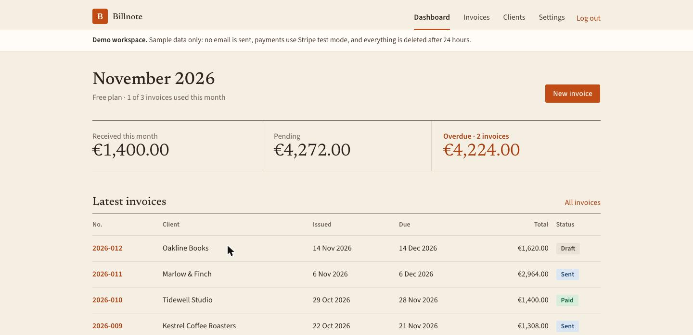

# Billnote

Simple invoicing for freelancers: add your clients, create an invoice in under a minute, download it as a PDF or email it, and see at a glance what is paid, pending or overdue. Free plan with 3 invoices a month, Pro plan by card through Stripe.

**Live demo: https://mvp-invoices-demo.vercel.app** — click **Try the demo**. No sign-up needed: you get your own workspace filled with sample data, deleted after 24 hours. No email is sent, and payments use Stripe test mode (card `4242 4242 4242 4242`, any future date, any CVC).



## Features

- Sign up, log in, password reset by email, terms acceptance at sign-up
- Clients: add, edit, delete
- Invoices with several lines, VAT and totals, unique numbers per year (`2026-001`)
- PDF download with the company details, and the logo on the Pro plan
- Email the invoice to the client with the PDF attached (Resend)
- Statuses: draft, sent, paid, overdue (set automatically after the due date)
- Dashboard: received this month, pending, overdue, latest invoices
- Free plan limited to 3 invoices a month, Pro plan at €9/month through Stripe Checkout
- Admin page listing sign-ups, visible to admin accounts only
- One-click demo workspace, with no account

## Stack

Next.js 16 (App Router, Server Actions) · React 19 · TypeScript · Tailwind CSS 4 and shadcn/ui · Supabase (Postgres, Auth, Storage, row level security) · Stripe (Checkout, subscriptions, webhooks) · Resend · `@react-pdf/renderer` · Vercel

## How it is built

**Security lives in the database, not in the interface.** Every table has row level security: a freelancer can never read or change another freelancer's clients, invoices or logo, even by calling the API directly. Admin access is checked by the database too.

**Business rules are enforced by Postgres.** The free plan limit, invoice numbering, creation and payment dates, and the lock on sent invoices are handled by triggers. The interface only warns the user before the database refuses.

**Stripe is the source of truth for the plan.** The webhook verifies the Stripe signature on the raw body, then reads the subscription from Stripe instead of trusting the event payload, so a replayed or out-of-order event cannot set the wrong plan. On error it returns 500, so Stripe retries.

**The demo uses real rules.** "Try the demo" opens an anonymous Supabase session and fills a private workspace. It follows the same row level security and plan limits as a real account, cannot see real accounts, and is purged after 24 hours.

**Every database change is a migration** in `supabase/migrations/`, never a manual edit in the Supabase dashboard.

## Tests

The database rules are tested against the real migrations, run in [PGlite](https://pglite.dev) (Postgres in WebAssembly, no Docker): 56 checks covering data isolation between freelancers, admin access, invoice locking, numbering, the free plan limit, logo storage and the demo workspace.

```bash
npm run test:db     # database rules
npm run typecheck
npm run lint
```

## Run it locally

You need a Supabase project, and optionally Stripe (test mode) and Resend accounts.

```bash
npm install
cp .env.example .env.local    # fill in the values, see comments in the file
npx supabase link --project-ref <your-project-ref>
npx supabase db push          # apply the migrations to your Supabase project
npm run dev
```

Open http://localhost:3000.

## Project layout

```
src/app/(auth)/           sign up, log in, password reset
src/app/(app)/            dashboard, clients, invoices, settings, Pro plan, admin
src/app/api/stripe/       Stripe webhook
src/lib/                  Supabase clients, Stripe, PDF, email, plan rules
src/proxy.ts              session refresh and protected routes
supabase/migrations/      database schema, policies and triggers
supabase/tests/           database tests (PGlite)
```

## Copyright

© 2026 Dabin Simon. All rights reserved.

This code is shared publicly as a portfolio sample. No license is granted: you may read it, but you may not copy, modify, distribute or reuse it, in whole or in part, without written permission.
